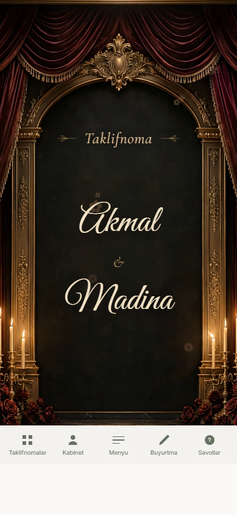
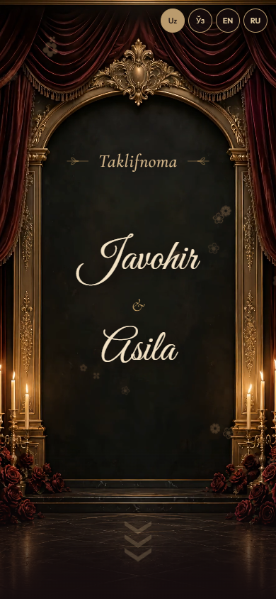

# Velvet Royale verification — 2026-10-28

Reference: [Velvet Royale](https://e-invitation.uz/preview/velvet-royale/).
Template ID: `royal-burgundy-edition`.

Release result: catalog publication is verified in the configured database and
public catalog at the preserved 1,000 UZS testing price. Source checks pass 6/6,
browser checks 12/12, backend integration 1/1, syntax, typecheck and production
build. No external application deployment was performed.

The renderer now uses the source DOM and original scoped CSS. The app captures
contain synthetic creator data, so names and text lengths differ from the
provider's sample. The reference capture includes its surrounding website's
bottom navigation; that bar is outside the invitation template. These screenshots
are evidence of presentation, not proof of motion.

| Source | Application |
| --- | --- |
|  |  |

Additional captures: [envelope](app-mobile-envelope.png),
[couple](app-mobile-couple.png), [photo album](app-mobile-photo-story.png),
[calendar](app-mobile-datetime.png), [gift card](app-mobile-card.png),
[RSVP](app-mobile-rsvp.png), [family](app-mobile-family.png),
[desktop](app-desktop-hero.png).
The real application catalog preview is also captured in
[catalog envelope](app-catalog-envelope.png); `catalog-preview-report.json`
verifies its six source preview photos, shared fixture and Google Maps target.

`browser-report.json` records separate motion and interaction checks at 390 px
and 1280 px: idle engraving, seal release, source video/final reveal, hero video,
calendar sequence and particle bursts, album controls/automatic advance,
four locales, music/pause preservation, creator data/empty sections, Google Place
and manual links, long names and reduced motion. Submission transport is mocked
only in this standalone check; the backend integration uses actual endpoints.

`integration-report.json` records the authenticated four-locale save/reopen,
real shared publication transaction, personalized public rendering, real RSVP
storage and pending moderated wish, followed by published edit/reopen and a
manual Google Maps target. All generated accounts, invitations, guest responses,
audit rows and queued wish notification jobs are deleted. No Telegram processor
or payment provider is invoked. The template remains hidden throughout that
verification; its temporary transaction-local flag is restored before commit.

`publication-report.json` records the applied release migration and the final
configured database/public catalog result. The migration changes only this
template's availability and wedding assignment, preserving its administrator
price. Application deployment is separate.

Commands run from the repository root:

```powershell
node --import tsx --test tests/velvet-royale-template.test.ts
node --check apps/web/public/templates/velvet-royale/renderer.js
pnpm typecheck
pnpm build
```

Standalone browser reproduction: serve `apps/web/public` at
`http://127.0.0.1:8765`, then run `node tests/velvet-royale.browser.cjs`.
Backend reproduction: start the local development app on port 3001 with its
configured environment and run:

```powershell
node --env-file=apps/web/.env.local --import tsx --test tests/velvet-royale.integration.ts
```

The browser scripts accept `CHROME_EXECUTABLE`; the default is the installed
Windows Chrome. Authentication integration requires the development server for
local HTTP; the production build correctly requires HTTPS authentication.

Known optional source gap: guest seating has no shared editor/storage/resolver
field. Its source card/illustration are retained, but no sample table number is
published. Short Google Maps links preserve exact navigation; without resolved
coordinates or a parseable full query, an embedded pin is omitted. The editor's
`GOOGLE_MAPS_API_KEY` stays server-only; navigation/embeds expose no key.
